# Synthetic hands generator

<p align="center">
  <a href="https://javimol.github.io/synthetic-hands-generator/viewer/hand-viewer.html">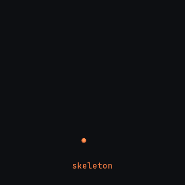</a>
</p>

Generates synthetic **depth images of human hand postures** from a 27-DOF
kinematic hand model. Runs in MATLAB and GNU Octave, with no toolboxes
required.

This is the generator behind the synthetic part of the hand gesture corpus in
the PhD thesis *Contributions to Hand Gesture Recognition on the basis of
Range Data* (Javier Molina Vela, Universidad Autónoma de Madrid, 2012),
Sections 2.2 and 3.2. The thesis used it to train gesture classifiers on
synthetic data alone and then evaluate them on recordings of real people.

**[▶ Open the interactive viewer](https://javimol.github.io/synthetic-hands-generator/viewer/hand-viewer.html)** in your browser: pick any
gesture, change the hand and the point of view, and watch it become a depth
image. Nothing to install.

## Interactive viewer

[viewer/hand-viewer.html](viewer/hand-viewer.html) is the same model in the
browser: a single file with the whole posture dictionary embedded. It is
published with GitHub Pages: **[open the viewer](https://javimol.github.io/synthetic-hands-generator/viewer/hand-viewer.html)**. You can also
download the file and open it locally. It loads three.js from a CDN, so it
needs an internet connection.

- **Four render modes**: **Skeleton** (bones, joints and seed points),
  **Volume** (a ball on every seed point), **Voxels** (the dilated voxel
  grid) and **Depth** (the 144×176 image). Keys `1`–`4` switch between them.
  Rotate the hand freely in any direction; Depth shows the image the
  generator renders from that same point of view.
- **Voxel grid** 1× is the generator's grid, one voxel per depth-image pixel.
  2×–4× rebuild the same volume on a finer grid, for a smoother look.
- **Every gesture** of the five dictionaries, with sliders for the hand
  profile (scale, FP-AR, PW), the point of view and all 21 joint angles.
- **Copy link** shares exactly what is on screen: the gesture, render mode,
  profile, point of view, edited joints, voxel grid and camera. A link copied
  while the pipeline is playing opens with the animation playing. For example,
  [the 'I love you' sign as voxels](https://javimol.github.io/synthetic-hands-generator/viewer/hand-viewer.html#g=101&m=voxels&r=3).
- **Play the pipeline**, the animation at the top of this page.
- **Save depth PNG** writes the depth image with its stored values.

The JavaScript port renders pixel-identical depth images to the Octave code.
`tests/viewer_test.mjs` checks every posture under three profiles and points
of view. The animation is recorded with `viewer/tools/record_logo.mjs`.

[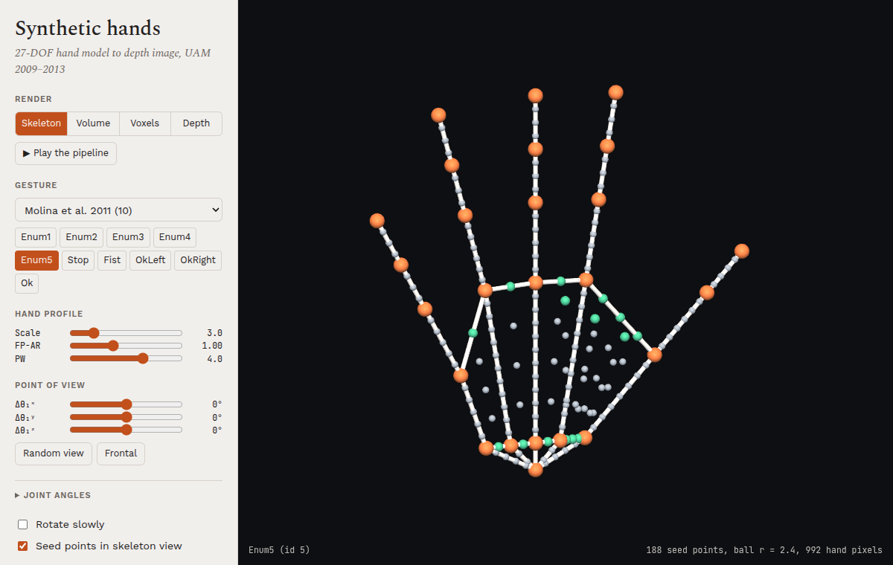](https://javimol.github.io/synthetic-hands-generator/viewer/hand-viewer.html)

## How it works

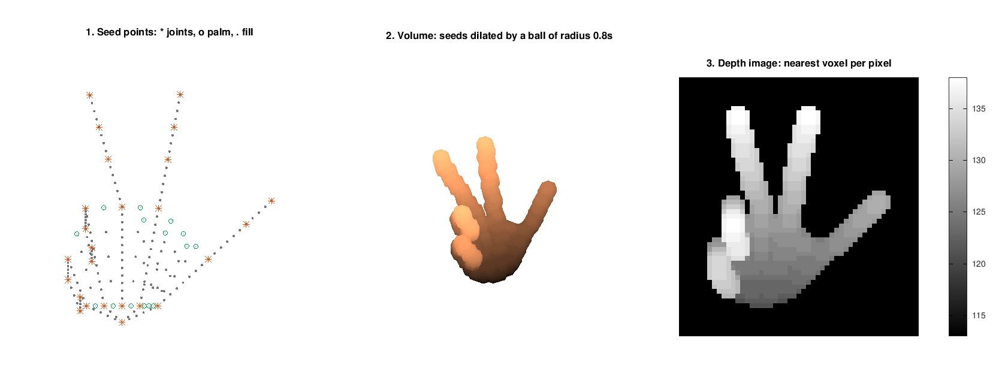

1. **Pose:** `generateHandParameters` returns the 27 parameters of a
   posture, picked by its dictionary id: 6 for the global rotation and
   position, 21 joint angles.
2. **Hand profile:** `generateUserProfiles` sets the anatomy: the scale,
   the finger/palm aspect ratio (FP-AR) and the palm width (PW). Varying
   these gives different "synthetic users".
3. **Skeleton:** `calculatePoints` applies forward kinematics to get the 3D
   joints, and adds fill points along every bone and across the palm.
4. **Volume:** `voxelizeHand` places these seed points in a 144×176×256
   voxel grid and dilates them with a ball of radius 0.8 × scale.
5. **Depth image:** `model2depthImage` keeps the nearest voxel along the
   view axis. The result is a 144×176 (QCIF) uint8 image, similar to a
   time-of-flight capture.

Each step is described in detail [below](#the-model-in-detail).

## Quick start

```matlab
setup_paths
d = renderDepthHand(5);                          % open hand, default profile
imshow(d, [])

d = renderDepthHand(8, 'Rotation', [pi/8 0 0], ... % fist, tilted
                       'Scale', 4, 'FingerPalmRatio', 1.2);

hands_demo                                       % writes output/*.png
```

To generate a whole dataset:

```matlab
addpath scripts
make_dataset('thesisB', 'Views', 20)  % profile set B of the thesis, 20 views per posture
make_videos('output/thesisB')         % optional: one AVI per profile and posture
```

`make_dataset` writes one PNG per sample (`<profile>_<posture>_<n>.png`) and an
`index.csv`. Each row of the index holds the profile, the posture, the hand
anatomy, the 27 pose parameters, and the image coordinates (row, column,
depth) of the wrist and of the index and little finger knuckles.

### Dataset presets

| Preset | What varies |
|---|---|
| `thesisA` … `thesisD` | The four profile sets of Table 3.1 in the thesis. Add `'Views', n` for #POV |
| `A` | Nothing: one frontal view of every posture |
| `B` | 10 random scales in [2.5, 7.5] |
| `C`, `G` | 10 random scales × 50 random views |
| `D`, `E`, `F` | 200, 500 or 1000 random views at scale 5 |
| `H2` | FP-AR ∈ {0.75, 1, 1.25} |
| `I2`, `I2c`, `I2e` | Grids of FP-AR × PW, one frontal view |
| `J2`, `J2e` | Grids of FP-AR × PW, 20 random views |
| `noisy` | 8 postures × a 3×3 grid of views × 20 copies with noisy joint angles |
| `soutschek` | The 5 postures of Soutschek et al. × 20 random views |

Random views add rotations Δθx ∈ [0, π/8] and Δθy, Δθz ∈ [−π/8, π/8], the
range used in the thesis. Any option can be overridden; see
`help make_dataset`.

## Gesture dictionaries

The generator has the pose-based gestures of the five dictionaries used in
the thesis (Section 2.3.1, Figure 2.3.1), 58 posture ids in all. Below,
every posture is rendered with the default profile, tilted by
θ<sub>1</sub><sup>x</sup> = π/16. Brighter pixels are closer to the camera.
Labels are the names used in the thesis, with the posture id in brackets.

**Molina et al. (2011)**: ids 1–5, 7, 8, 11, 12. Id 6 is an additional "Ok"
pose.

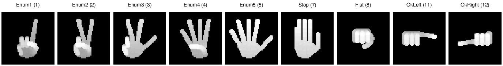

**Kollorz et al. (2008)**: ids 301–312.

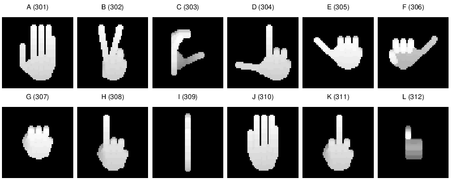

**Soutschek et al. (2008)**: ids 201–205. **Miscellaneous**: ids 101–104.

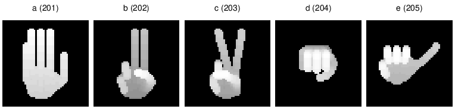
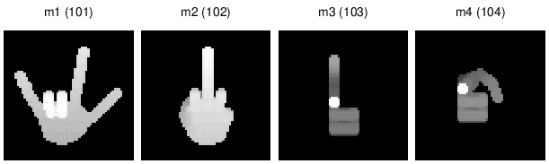

**Spanish Sign Language alphabet**: ids 401–427, in alphabetical order with
ñ. Only the hand shape is modelled, so letters signed with a movement are
static here. n and ñ share a pose, and so do u and v.

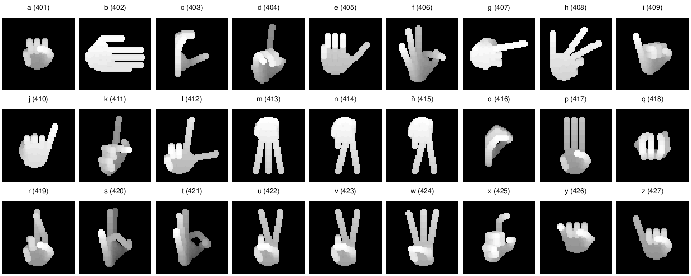

Ids that share a definition: 2 = 203 = 422 = 423, 7 = 201, 8 = 204,
205 = 306, 303 = 403 and 414 = 415. See `help generateHandParameters`.

## The model in detail

The model is the 27-DOF kinematic hand of Erol et al. (2007) and Ge et al.
(2006), as described in Sections 2.2 and 3.2 of the thesis. The values
below are those of the code. They differ in places from the text of the
thesis, which for example gives 4 × scale for the palm segments.

### Skeleton

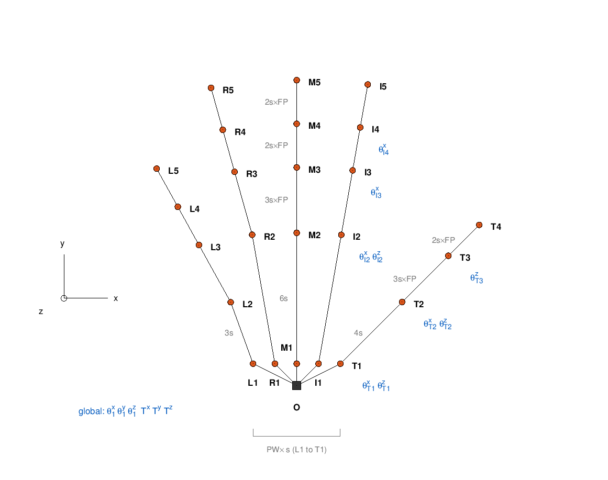

The skeleton is a tree rooted at the wrist O. Each finger has a base on the
palm (level 1), a knuckle (level 2) and further joints up to the tip (level
5, or level 4 for the thumb). Every joint has a homogeneous transform: a
translation along the parent segment, then a rotation
R = R<sub>x</sub>(θ<sup>x</sup>) R<sub>y</sub>(θ<sup>y</sup>)
R<sub>z</sub>(θ<sup>z</sup>). Positions come from chaining the transforms
from the wrist. Here the hand points up (+y), the thumb is on the +x side
and the camera looks down the z axis. All lengths are in voxels and scale
with the hand scale s (default 3).

| Segment | Length | Fixed rotation about z |
|---|---|---|
| O → T1, I1, M1, R1, L1 (finger bases) | s·PW/4 · (2, 1, 0, −1, −2) along x, s·PW/4 along y | |
| I1I2, M1M2, R1R2 (palm) | 6s | −π/18, 0, π/18 (finger splay) |
| L1L2 (palm, little finger) | 3s | π/9 |
| T1T2 (thumb metacarpal) | 4s | |
| T2T3, I2I3, M2M3, R2R3, L2L3 (proximal phalanx) | 3s · FP-AR | |
| T3T4, and the two distal phalanges of each finger | 2s · FP-AR | |

#### Joint parameters

These are the 27 fields of a pose struct, in the order of
`struct2plain`. Angles are in radians. The limits are those of
`checkRestrictions`. `make_dataset` applies them only to the noisy copies of
the `noisy` preset (`'NoiseSNR'`). Some dictionary postures fall outside
them; mostly the thumb, and the 180° turn of 407 (g).

| Parameters | Joint | What they do | Limits |
|---|---|---|---|
| `phi1_x`, `phi1_y`, `phi1_z` | O | Global rotation: the point of view | [0, π] each |
| `T1_x`, `T1_y`, `T1_z` | O | Global translation, in voxels. Ignored by default, because the hand is centred in the volume | [1, 256] |
| `phiT1_x`, `phiT1_z` | T1 | Thumb base: flexion, abduction | [0, π/4], [−π/3, −π/8] |
| `phiT2_x`, `phiT2_z` | T2 | Thumb knuckle: flexion, abduction | [−π/8, π/8], [−π/4, π/2] |
| `phiT3_z` | T3 | Thumb distal joint | [0, π/2] |
| `phiF2_x`, `phiF2_z` | F2 | Knuckle of finger F = I, M, R, L: flexion, abduction | [0, π/2], [−π/8, π/8] |
| `phiF3_x` | F3 | Middle joint: flexion | [0, π/2] |
| `phiF4_x` | F4 | Distal joint: flexion | [0, π/2] |

Flexion is a rotation about x, so a positive angle bends the finger towards the camera (+z), in front of the palm.

### Hand profiles (synthetic users)

Two parameters from Section 3.2.2 of the thesis change the anatomy without
changing the pose:

- **FP-AR**, the finger/palm aspect ratio, multiplies the length of every
  phalanx. The palm keeps its length.
- **PW**, the palm width, spaces the finger bases s·PW/4 apart, so the
  thumb base T1 is s·PW from the little finger base L1.

The thesis builds its training sets from grids of these values (Table 3.1,
presets `thesisA` to `thesisD`). This is set B, posture 5:

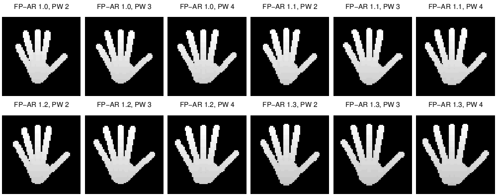

### Seed points and dilation

A volume needs more than the joints. `calculatePoints` adds:

- **Fill points (·)** along every bone, from the wrist to the tips, about
  s/2 apart.
- **Palm points (o)** at the finger bases (level 1) and at the knuckles
  (level 2). They sit at the midpoints of I–M, M–R and R–L, and at three
  points along T–I. Level 2 adds three more along T2–M2. Each level-1
  point is joined to its level-2 counterpart by a line of fill points,
  which fills in the palm.

`voxelizeHand` maps the points to the voxel grid. Its rows are the image
rows (−y), its columns the image columns (+x) and its pages the depth (+z).
The hand is centred in the 144×176×256 grid, and the function warns when it
gets within 25 voxels of a border. Each seed point sets one voxel. The
volume is then dilated with a Euclidean ball of radius 0.8·s, which turns
every bone into a capsule and the palm into a slab (`dilateBall`: a voxel
is in the ball when its rounded distance to the centre is ≤ r). The
original code used the dilation of the proprietary SDC Morphology Toolbox;
`dilateBall` matches it to within 2–3% of the silhouette pixels.

### Depth image

`model2depthImage` projects the volume orthographically along z. Each
pixel gets the index of the highest occupied page in its column, so larger
values are closer to the camera and background pixels are 0. The result is
a 144×176 uint8 image, the QCIF resolution of the SR4000 time-of-flight
camera used for the real recordings. The camera is fixed: points of view
come from rotating the hand with θ<sub>1</sub>, as in Figure 2.2.2 of the
thesis:

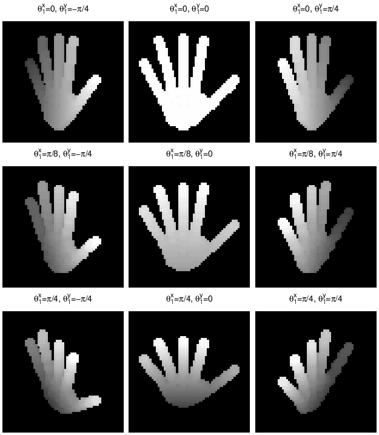

## Repository layout

```
src/                     the generator
  renderDepthHand.m      one call from posture id to depth image
scripts/
  make_dataset.m         datasets, with presets for the thesis sets
  make_videos.m          per-posture AVI videos from a dataset folder
  demo_skeleton.m        skeleton, voxel volume and depth image of a posture
  demo_points_of_view.m  one posture from a 3×3 grid of views
viewer/
  hand-viewer.html       interactive viewer (three.js), a single file
  export_postures.m      embeds the posture dictionary in the viewer
  tools/record_logo.mjs  records docs/img/logo.gif from the viewer
tests/
  smoke_test.m           renders every posture and checks reference outputs
  viewer_test.mjs        compares the viewer's depth images with Octave's
hands_demo.m             renders a contact sheet of postures
docs/make_figures.m      renders the figures of this README
```

Run the tests from the repository root:

```sh
octave --no-gui --eval "run('tests/smoke_test.m')"
octave --no-gui --eval "run('tests/export_viewer_reference.m')"
node tests/viewer_test.mjs
```

After changing the postures in `generateHandParameters`, run
`viewer/export_postures.m` to update the viewer.

## Changes from the thesis code

The images match the original generator pixel for pixel, apart from the
toolbox replacement described first. The other changes:

- **Toolbox-free dilation.** The volume used to be dilated with the
  proprietary SDC Morphology Toolbox. It is replaced by `dilateBall`. Checked
  against images rendered in 2013, the silhouettes agree to within about
  2–3% of the pixels.
- **One dataset script.** The 16 original batch scripts are now presets of
  `make_dataset`. Several of them no longer ran against the final generator
  code.
- **Profile grids.** In the original code the finger/palm ratio was
  multiplied cumulatively across a grid. For example, FP-AR {1, 1.1, 1.2, 1.3}
  actually produced 1, 1.1, 1.32 and 1.716. Each value is now applied as
  given. The unused thickness (`grosor`) parameter, which duplicated every
  profile, is gone.
- **Keypoints.** The original alignment-point files mixed two coordinate
  frames. `index.csv` gives the keypoints in image coordinates.
- **Videos.** Frames are grouped by profile and posture. Before, frames of
  different profiles were mixed into the same video.
- **Smaller fixes.**
  - Datasets are seeded and reproducible.
  - Postures are rendered as defined. Several original scripts clamped
    every posture to the joint limits, which moved the thumb in about 13
    postures and undid the 180° turn of g (407). Now only the noisy copies
    are clamped.
  - The `noisy` preset perturbs only the joint angles. Before, the clamping
    step undid the negative view rotations.
  - Calls to toolbox or removed functions are replaced: `wgn`, `avifile`,
    `imresize`.
  - Comments and identifiers are translated to English.

## Citation

If you use this code, please cite the thesis:

```bibtex
@phdthesis{molina2012thesis,
  author = {Molina Vela, Javier},
  title  = {Contributions to Hand Gesture Recognition on the basis of Range Data},
  school = {Universidad Aut\'onoma de Madrid},
  year   = {2012}
}
```

and, for the synthetic training framework, the paper:

```bibtex
@article{molina2014synthetic,
  author  = {Molina, Javier and Mart\'inez, Jos\'e M.},
  title   = {A synthetic training framework for providing gesture scalability
             to 2.5D pose-based hand gesture recognition systems},
  journal = {Machine Vision and Applications},
  volume  = {25},
  number  = {5},
  year    = {2014},
  doi     = {10.1007/s00138-014-0620-7}
}
```

## License

MIT. See [LICENSE](LICENSE).
