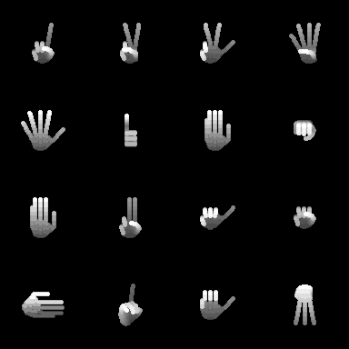

# Synthetic hands generator

Generates synthetic **depth images of human hand postures** from a 27-DOF
kinematic hand model. Runs in MATLAB and GNU Octave, with no toolboxes
required.



This is the generator behind the synthetic part of the hand gesture corpus in
the PhD thesis *Contributions to Hand Gesture Recognition on the basis of
Range Data* (Javier Molina Vela, Universidad Autónoma de Madrid, 2012),
Sections 2.2 and 3.2. The thesis used it to train gesture classifiers on
synthetic data alone and then evaluate them on recordings of real people.

> **Status:** research code from 2009–2013, cleaned up and published for
> reference. It is not actively developed.

## How it works

1. **Pose:** `generateHandParameters` gives the 27 pose parameters of a
   posture, picked by its dictionary id. These are the global rotation and
   position plus 21 joint angles.
2. **Hand profile:** `generateUserProfiles` sets the anatomy: the scale, the
   finger/palm aspect ratio (FP-AR) and the palm width (PW). Varying these
   gives different "synthetic users".
3. **Skeleton:** `calculatePoints` applies forward kinematics to get the 3D
   joints, plus fill points along every bone and across the palm.
4. **Volume:** `voxelizeHand` puts the skeleton in a 144×176×256 voxel grid
   and dilates it with a ball of radius 0.8 × scale.
5. **Depth image:** `model2depthImage` keeps the nearest surface along the
   view axis. The result is a 144×176 (QCIF) uint8 image, similar to a
   time-of-flight capture.

## Quick start

```matlab
setup_paths
d = renderDepthHand(5);                          % open hand, default profile
imshow(d, [])

d = renderDepthHand(8, 'Rotation', [pi/8 0 0], ... % fist, tilted
                       'Scale', 4, 'FingerPalmRatio', 1.2);

hands_demo                                       % writes output/*.png
```

To generate a whole dataset:

```matlab
addpath scripts
make_dataset('thesisB', 'Views', 20)  % profile set B of the thesis, 20 views per posture
make_videos('output/thesisB')         % optional: one AVI per profile and posture
```

`make_dataset` writes one PNG per sample (`<profile>_<posture>_<n>.png`) and an
`index.csv`. Each row of the index holds the profile, the posture, the hand
anatomy, the 27 pose parameters, and the image coordinates (row, column,
depth) of the wrist and of the index and little finger knuckles.

### Dataset presets

| Preset | What varies |
|---|---|
| `thesisA` … `thesisD` | The four profile sets of Table 3.1 in the thesis. Add `'Views', n` for #POV |
| `A` | Nothing: one frontal view of every posture |
| `B` | 10 random scales in [2.5, 7.5] |
| `C`, `G` | 10 random scales × 50 random views |
| `D`, `E`, `F` | 200, 500 or 1000 random views at scale 5 |
| `H2` | FP-AR ∈ {0.75, 1, 1.25} |
| `I2`, `I2c`, `I2e` | Grids of FP-AR × PW, one frontal view |
| `J2`, `J2e` | Grids of FP-AR × PW, 20 random views |
| `noisy` | 8 postures × a 3×3 grid of views × 20 copies with noisy joint angles |
| `soutschek` | The 5 postures of Soutschek et al. × 20 random views |

Random views add rotations Δθx ∈ [0, π/8] and Δθy, Δθz ∈ [−π/8, π/8], the
range used in the thesis. Any option can be overridden; see
`help make_dataset`.

## Posture ids

| Ids | Postures |
|---|---|
| 1–8 | One, Two, Three, Four, Five, Ok, Stop, Fist |
| 11, 12 | Additional postures (unnamed in the source) |
| 101–104 | Miscellaneous pose-based dictionary |
| 201–205 | Dictionary of Soutschek et al. (2008) |
| 301–312 | 12-pose dictionary of Kollorz et al. (2008) |
| 401–427 | Spanish Sign Language alphabet, static letters a–z |

Some ids share a definition. For example, 2, 203, 422 and 423 are the same
pose. See `help generateHandParameters`.

## Repository layout

```
src/                     the generator
  renderDepthHand.m      one call from posture id to depth image
scripts/
  make_dataset.m         datasets, with presets for the thesis sets
  make_videos.m          per-posture AVI videos from a dataset folder
  demo_skeleton.m        skeleton, voxel volume and depth image of a posture
  demo_points_of_view.m  one posture from a 3×3 grid of views
tests/smoke_test.m       renders every posture and checks reference outputs
hands_demo.m             renders the contact sheet above
```

Run the tests with `octave --no-gui --eval "run('tests/smoke_test.m')"`.

## Changes from the thesis code

The images match the original generator pixel for pixel, apart from the
toolbox replacement described first. The other changes:

- **Toolbox-free dilation.** The volume used to be dilated with the
  proprietary SDC Morphology Toolbox. It is replaced by `dilateBall`. Checked
  against images rendered in 2013, the silhouettes agree to within about
  2–3% of the pixels.
- **One dataset script.** The 16 original batch scripts are now presets of
  `make_dataset`. Several of them no longer ran against the final generator
  code.
- **Profile grids.** In the original code the finger/palm ratio was
  multiplied cumulatively across a grid. For example, FP-AR {1, 1.1, 1.2, 1.3}
  actually produced 1, 1.1, 1.32 and 1.716. Each value is now applied as
  given. The unused thickness (`grosor`) parameter, which duplicated every
  profile, is gone.
- **Keypoints.** The original alignment-point files mixed two coordinate
  frames. `index.csv` gives the keypoints in image coordinates.
- **Videos.** Frames are grouped by profile and posture. Before, frames of
  different profiles were mixed into the same video.
- **Smaller fixes.**
  - Datasets are seeded and reproducible.
  - The `noisy` preset perturbs only the joint angles. Before, the clamping
    step undid the negative view rotations.
  - Calls to toolbox or removed functions are replaced: `wgn`, `avifile`,
    `imresize`.
  - Comments and identifiers are translated to English.

## Citation

If you use this code, please cite the thesis:

```bibtex
@phdthesis{molina2012thesis,
  author = {Molina Vela, Javier},
  title  = {Contributions to Hand Gesture Recognition on the basis of Range Data},
  school = {Universidad Aut\'onoma de Madrid},
  year   = {2012}
}
```

The synthetic training framework is described in J. Molina and
J. M. Martínez, *A synthetic training framework for providing gesture
scalability to 2.5D pose-based hand gesture recognition systems*, Machine
Vision and Applications, 2014.

## License

MIT. See [LICENSE](LICENSE).
